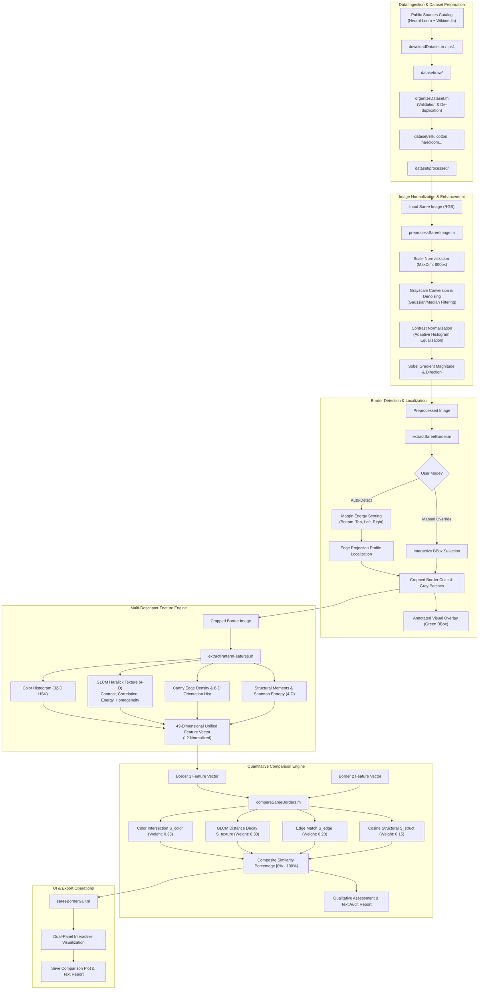
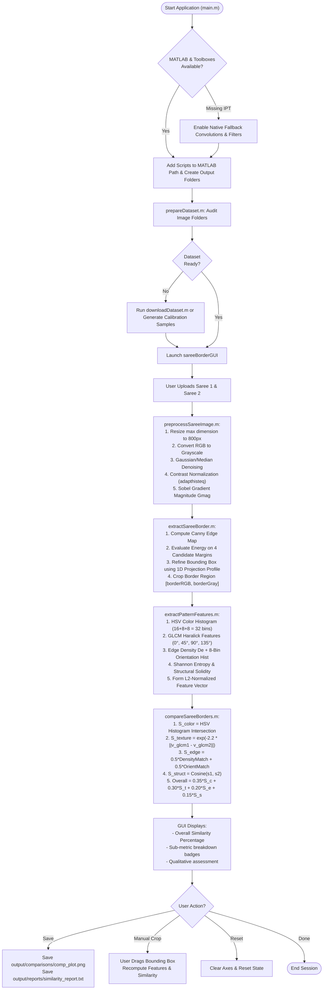
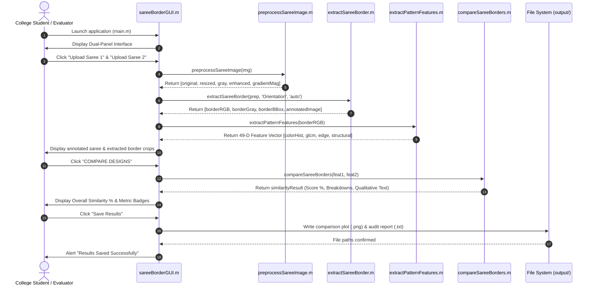

# System Architecture & Algorithm Flowcharts

## Project: Saree Border Pattern Extraction & Design Similarity Comparison Using MATLAB

---

## 1. High-Level System Architecture

---

## 2. Detailed Algorithm Pipeline Flowchart

---

## 3. Data Processing Sequence Diagram

